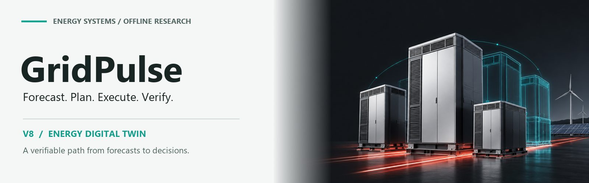
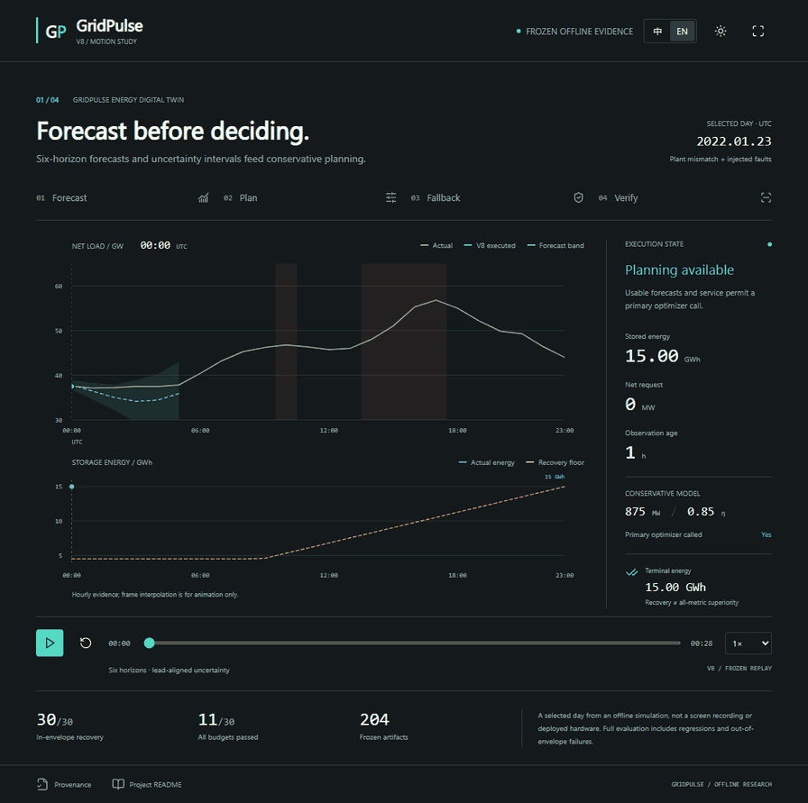
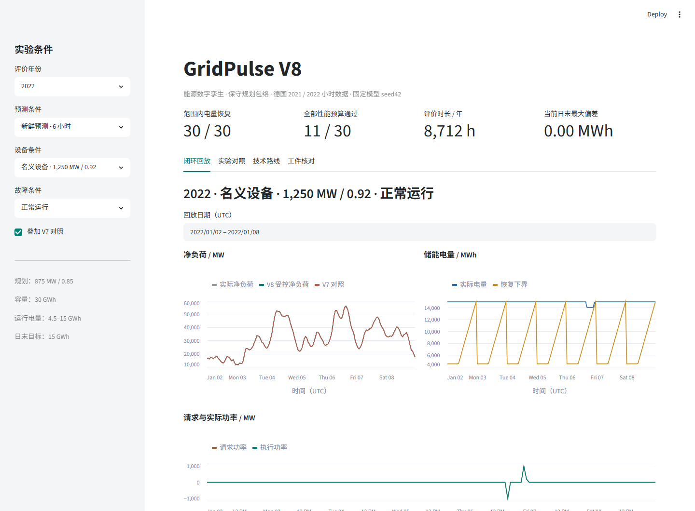
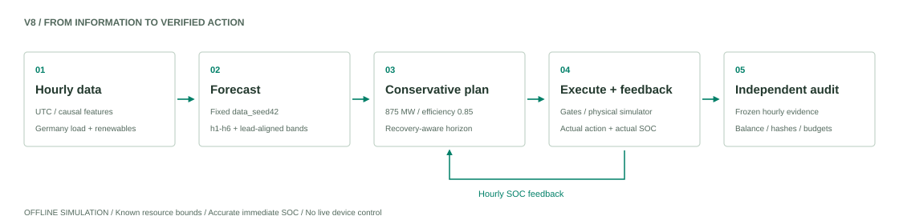
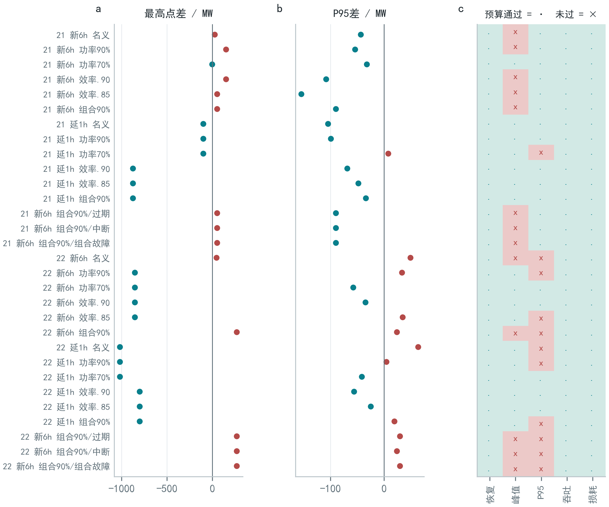

<div align="center">

**简体中文** · [English](README_EN.md)

<picture>
  <source media="(prefers-color-scheme: dark)" srcset="assets/readme/banner-dark.png">
  
</picture>

**能源数字孪生，从预测走向可核验的决策。**

<code>Python 3.12</code> · <code>Streamlit</code> · <code>PyTorch</code> · <code>MIT Code</code>

[观看演示](#动态演示) · [快速开始](#快速开始) · [技术报告](docs/reports/GridPulse-technical-report.pdf) · [离线展示合集](preview/index.html) · [验证记录](docs/verification.md)

</div>

---

GridPulse 是一个面向电力净负荷与储能调度的**离线研究原型**。当前 `fusion_v8` 将六时距预测、保守滚动规划、物理执行、SOC 反馈和逐小时证据核对连接起来。这里提供可运行的应用、可检查的证据，以及没有被隐藏的性能取舍。

| 日末电量恢复 | 全部性能预算通过 | 冻结工件核对 |
| :---: | :---: | :---: |
| **30 / 30** 范围内轨迹 | **11 / 30** 范围内轨迹 | **204** 个工件 |

**恢复可行，不等于全指标占优。** 结果仅适用于声明条件下的历史离线仿真，不代表生产部署或任意设备上的保证。封面为项目概念配图。

## 动态演示

<a href="docs/showcase/index.html">
  <picture>
    <source media="(prefers-reduced-motion: reduce)" srcset="assets/readme/demo-poster.png">
    
  </picture>
</a>

**预测 → 规划 → 回退 → 核对。** 28 秒 SVG 动画使用冻结工件中的真实曲线，展示一个选取日的预测区间、故障门控和电量恢复。它是数据驱动的说明动画，**不是应用录屏、实时求解或实机运行录像**。

[HTML/SVG 播放器](docs/showcase/index.html) · [静态封面](assets/readme/demo-poster.png) · [数据溯源](docs/showcase/provenance.json)

**仓库内已包含全部展示文件：**[单文件动画](preview/GridPulse-SVG演示.html) · [中文预览](preview/README预览.html) · [英文预览](preview/README_EN预览.html)。双语预览与截图统一收纳在 [`preview/`](preview/index.html)，上传本仓库即可一并带上。

> GitHub README 内显示动图预览；仓库中的 HTML 链接默认打开源码。下载仓库后可直接用浏览器打开 `docs/showcase/index.html`，无需服务器；也可按[演示发布说明](docs/showcase/README.md)部署至 GitHub Pages。

<details>
<summary><b>查看实际应用界面与四个视图</b></summary>



| 视图 | 内容 |
| :--- | :--- |
| 闭环回放 | 净负荷、SOC、请求与实际功率，以及回退日志 |
| 实验对照 | 三种策略的逐条件指标，保留预算退步和失败 |
| 技术路线 | 数据、预测、规划、执行与反馈的实现对应 |
| 工件核对 | 冻结工件、候选选择、轨迹哈希和完成状态 |

应用读取冻结结果。切换场景用于回放与比较，不会重新训练模型或控制设备。

</details>

## 快速开始

使用 **Python 3.12**，在仓库根目录执行：

```bash
python -m venv .venv
```

<details>
<summary><b>激活环境：Windows / macOS / Linux</b></summary>

```powershell
# Windows PowerShell
.\.venv\Scripts\Activate.ps1
```

```bash
# macOS / Linux
source .venv/bin/activate
```

</details>

```bash
python -m pip install -r requirements.txt
python run.py
```

打开 **http://localhost:8501**。不需要 API Key，也不需要重新训练模型或下载数据。首次启动会校验随附证据并恢复到本地，约需 **407 MiB** 证据空间，另计依赖环境。

<details>
<summary><b>端口冲突、分步启动与证据修复</b></summary>

```bash
# 更换端口
python run.py --server.port 8502

# 分步准备并启动
python scripts/prepare_release.py
python -m streamlit run app.py

# 只核对，不写入
python scripts/prepare_release.py --verify-only
```

准备脚本校验 6 个压缩包与 250 个文件的 SHA-256。重复运行保留相同文件；
发现本地证据被修改时停止，不会静默覆盖。只有在备份修改后，才使用 `--repair` 恢复原证据。
不要删除 `artifacts/`；恢复后的数据、输出与虚拟环境不提交 Git。

</details>

## 技术路线

<picture>
  <source media="(prefers-color-scheme: dark)" srcset="assets/readme/architecture-dark.svg">
  
</picture>

| 阶段 | 设计要点 | 代码 |
| :--- | :--- | :--- |
| 预测 | 因果特征、固定 seed42、直接输出 `h1–h6` | [多时距模型](src/multihorizon_fusion.py) |
| 门控 | 保留原预测时距；检查观测年龄与服务状态 | [延迟适配](src/delayed_forecasts.py) · [反馈控制](src/feedback_control.py) |
| 规划 | 同一 875 MW / 0.85 模型用于窗口和参考电量 | [保守规划](src/envelope_planning.py) |
| 执行 | 按实际设备与 SOC 限幅，逐小时回传状态 | [恢复控制](src/recovery_control.py) · [执行与反馈](src/feedback_control.py) |
| 核对 | 冻结指标、逐小时能量平衡与同条件对照 | [证据读取](src/fusion_evidence.py) · [独立复算](scripts/verify_envelope_results.py) |

完整方法见[技术路线文档](docs/architecture.md)与 [V8 实验协议](experiments/fusion_v8/protocol.md)。

## 实验证据

候选 `envelope_tail` 在验证期锁定，再对固定模型和既定条件进行评价。范围内电量恢复全部通过，但仅 **11 / 30** 条轨迹同时满足峰值、P95、吞吐和损耗预算。

| 记录 | 数值与范围 |
| :--- | :--- |
| 评价数据 | 德国 2021 / 2022；各 **363** 个完整 UTC 日、**8,712** 小时 |
| 规划与储能 | **875 MW / 0.85**；容量 **30 GWh**，运行电量 **4.5–15 GWh** |
| 独立核对 | **204** 个工件、**114** 条轨迹、**96** 组配对区间 |
| 范围外反例 | 750 MW / 0.80 时仍失败；最大日末偏差 **642.96 / 589.59 MWh** |

<details>
<summary><b>展开全条件图、统计口径与适用边界</b></summary>



- 114 条核对轨迹包含复用的 V7 基线，不是 114 次独立试验。
- 配对区间属于探索性比较，不作确认性赢家推断。
- 评价年份此前已多轮检查，结果不视为独立未知电网上的确认性证据。
- 假设准确即时的 SOC 回传，资源下界预先给定；没有在线设备参数辨识。
- 日末目标为 15 GWh。恢复通过不构成实机安全认证、收益承诺或全面性能优势。
- 动画中的 2022-01-23 是为同时展示故障和储能动作而选取的说明日，不是无偏性能样本。

</details>

直接查看：[冻结指标](evidence/v8/metrics.json) · [选择决策](evidence/v8/decision.json) · [完整实验报告](docs/fusion-envelope-report.md)

## 复现与验证

```bash
python scripts/prepare_release.py
python scripts/verify_envelope_results.py
python scripts/check_app.py
```

上述 V8 核算与界面检查不需要 PyTorch。完整回归测试还需：

```bash
python -m pip install -r requirements-training.txt
python -m pytest
```

最近的本地验证记录：**215 项通过，2 项可选历史工件测试按设计跳过**；桌面与手机界面均经过浏览器检查。该记录不是 GitHub Actions 的远程状态。详见[验证记录](docs/verification.md)。

<details>
<summary><b>原实验、当前源码与环境的区别</b></summary>

原 V8 源码保存在 [`frozen_source/`](experiments/fusion_v8/frozen_source/)，按原 manifest 核对。
当前应用及校验修订单独保留；当前回归通过不等于在原硬件重新训练完成。
原实验环境以 [`manifest.json`](evidence/v8/manifest.json) 为准。

本仓库验证范围为 V8 回放、证据恢复、当前测试与独立核算。V1–V7 全部工件、
历史报告/PPT 的重新生成仍可能需要原完整工作区。
[Research Checks](.github/workflows/ci.yml) 已配置，但实际运行状态以上传后的 Actions 为准。

</details>

## 项目结构

<details>
<summary><b>展开仓库目录</b></summary>

```text
gridpulse-energy-twin/
|-- app.py / run.py       # 原界面与证据准备入口
|-- src/                 # 预测、规划、执行和证据读取
|-- tests/               # 算法与发布流程回归测试
|-- scripts/             # 实验、独立复算与报告工具
|-- experiments/         # V1–V8 协议与 V8 冻结源码
|-- artifacts/           # 证据包与完整哈希清单
|-- evidence/            # 可直接浏览的指标和来源
|-- assets/readme/       # 品牌图片、SVG 路线图与动图
|-- docs/showcase/       # 离线 HTML/SVG 动画播放器
|-- preview/             # 单文件动画、双语 HTML 预览与截图
|-- docs/reports/        # 技术报告 PDF
|-- report_assets/       # 报告源稿、图表与数据
`-- .github/             # CI、可选 Pages 与协作模板
```

`outputs/` 和 `data/processed/` 在准备后恢复，不进入 Git。历史输出、运行环境、
工作缓存与重复交付包保留在本地，不属于公开仓库。详见[发布范围](docs/release-scope.md)。

</details>

## 文档导航

| 你想做什么 | 入口 |
| :--- | :--- |
| 观看交互式 SVG 演示 | [播放器](docs/showcase/index.html) · [使用与 Pages 部署](docs/showcase/README.md) |
| 阅读方法与结论 | [技术报告 PDF](docs/reports/GridPulse-technical-report.pdf) · [V8 实验报告](docs/fusion-envelope-report.md) |
| 运行与核算 | [复现指南](docs/reproducibility.md) · [发布验证](docs/verification.md) |
| 检查数据和归属 | [数据字典](docs/data-dictionary.md) · [第三方声明](THIRD_PARTY_NOTICES.md) |
| 发布或参与维护 | [上传指南](docs/publishing.md) · [贡献指南](CONTRIBUTING.md) |

## 许可与边界

原创代码采用 [MIT License](LICENSE)。数据、第三方软件和素材仍按各自条款使用；
OPSD 与 Energy-Charts 的引用及再分发注意事项见[第三方声明](THIRD_PARTY_NOTICES.md)。
演示使用的真实曲线保留[来源哈希](docs/showcase/provenance.json)，项目配图保留[素材说明](assets/readme/README.md)。

这是研究原型，不应用作自主电网控制系统。[安全与披露政策](SECURITY.md)

---

<div align="center">
<b>GridPulse</b> · Forecast. Plan. Execute. Verify.<br>
<a href="#动态演示">返回演示</a> · <a href="README_EN.md">English</a>
</div>
