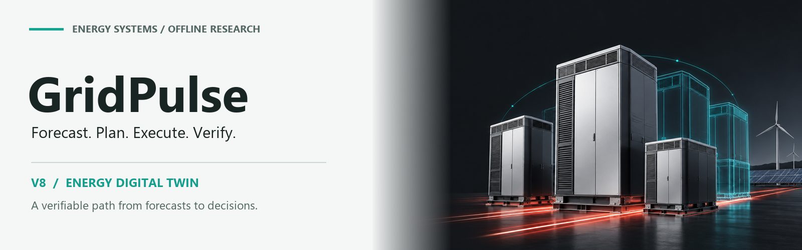
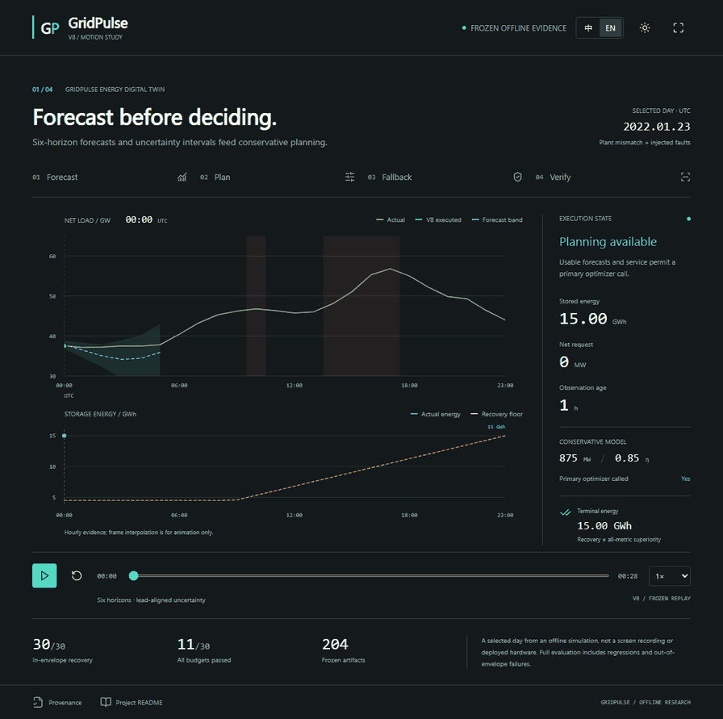
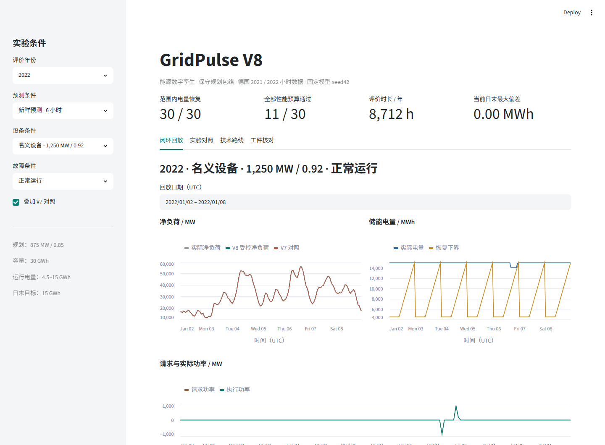
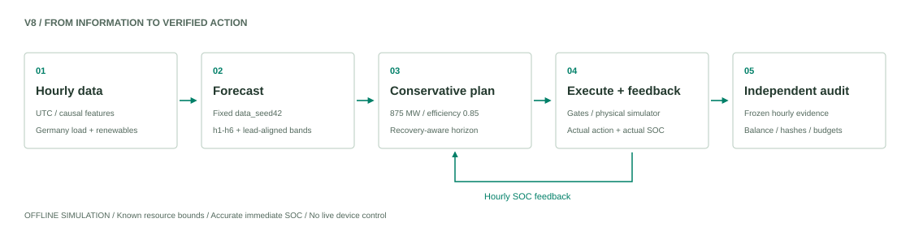
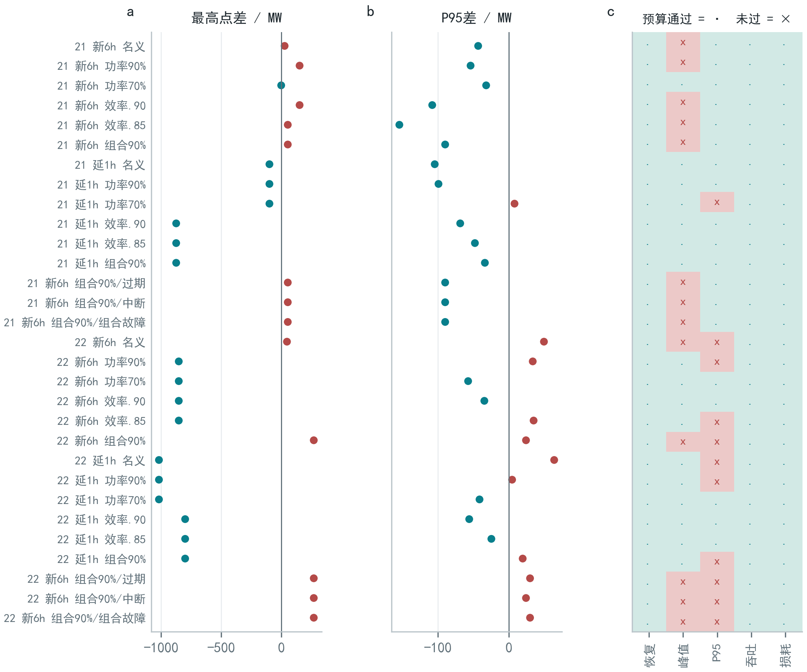

<div align="center">

[简体中文](README.md) · **English**

<picture>
  <source media="(prefers-color-scheme: dark)" srcset="assets/readme/banner-dark.png">
  
</picture>

**An energy digital twin, from forecasts to verifiable decisions.**

<code>Python 3.12</code> · <code>Streamlit</code> · <code>PyTorch</code> · <code>MIT Code</code>

[Watch the Demo](#motion-study) · [Quick Start](#quick-start) · [Technical Report](docs/reports/GridPulse-technical-report.pdf) · [Offline Previews](preview/index.html) · [Verification](docs/verification.md)

</div>

---

GridPulse is an **offline research prototype** for electricity net-load forecasting and storage scheduling. The current `fusion_v8` pipeline connects six-horizon forecasts, conservative rolling planning, simulated execution, SOC feedback, and independently auditable hourly evidence. This repository includes a runnable application, inspectable artifacts, and explicit performance trade-offs.

| Terminal energy recovery | All performance budgets | Frozen artifact checks |
| :---: | :---: | :---: |
| **30 / 30** in-envelope runs | **11 / 30** in-envelope runs | **204** artifacts |

**Recovery feasibility is not all-metric superiority.** Results concern historical offline simulation under declared conditions, not production deployment or guarantees for arbitrary equipment. The cover is a conceptual project illustration.

## Motion Study

<a href="docs/showcase/index.html?lang=en">
  <picture>
    <source media="(prefers-reduced-motion: reduce)" srcset="assets/readme/demo-poster.png">
    
  </picture>
</a>

**Forecast → plan → fall back → verify.** A 28-second SVG presentation uses real curves from frozen evidence to show forecast intervals, fault gates, and terminal recovery in a selected day. It is a data-driven explanation, **not a screen recording, live optimization, or deployed-device footage**.

[HTML/SVG Player](docs/showcase/index.html?lang=en) · [Static Poster](assets/readme/demo-poster.png) · [Data Provenance](docs/showcase/provenance.json)

**All presentation files are included in this repository:** [standalone animation](preview/GridPulse-SVG演示.html?lang=en), [Chinese preview](preview/README预览.html), and [English preview](preview/README_EN预览.html). Uploading this repository includes the complete [`preview/`](preview/index.html) collection and its screenshots.

> The README displays an animated preview. HTML links in the repository open source on GitHub. After downloading, open `docs/showcase/index.html` directly in a browser, without a server, or follow the [GitHub Pages guide](docs/showcase/README.md).

<details>
<summary><b>Actual application and its four views</b></summary>



| View | Content |
| :--- | :--- |
| Closed-loop replay | Net load, SOC, requested/executed power, and fallback logs |
| Experiment comparison | Three policies with budget regressions and failures retained |
| Method | Implementation of prediction, planning, execution, and feedback |
| Artifact checks | Frozen inventory, candidate selection, trace hashes, and completion |

The Chinese-language app reads frozen results. Selecting conditions changes replay and comparison, not model training or live device control.

</details>

## Quick Start

Use **Python 3.12** from the repository root:

```bash
python -m venv .venv
```

<details>
<summary><b>Activate on Windows / macOS / Linux</b></summary>

```powershell
# Windows PowerShell
.\.venv\Scripts\Activate.ps1
```

```bash
# macOS / Linux
source .venv/bin/activate
```

</details>

```bash
python -m pip install -r requirements.txt
python run.py
```

Open **http://localhost:8501**. No API key, retraining, or dataset download is required. First launch verifies and restores bundled evidence, requiring approximately **407 MiB** in addition to the dependency environment.

<details>
<summary><b>Ports, step-by-step startup, and evidence repair</b></summary>

```bash
# Use a different port
python run.py --server.port 8502

# Prepare evidence and launch separately
python scripts/prepare_release.py
python -m streamlit run app.py

# Verify without writing
python scripts/prepare_release.py --verify-only
```

Preparation checks SHA-256 for six ZIPs and 250 files. Repeated runs retain identical files.
Modified local evidence is never silently overwritten. Use `--repair` only after preserving your changes.
Keep `artifacts/`; restored data, outputs, and virtual environments are ignored by Git.

</details>

## Architecture

<picture>
  <source media="(prefers-color-scheme: dark)" srcset="assets/readme/architecture-dark.svg">
  
</picture>

| Stage | Design | Implementation |
| :--- | :--- | :--- |
| Forecast | Causal features, fixed seed42, direct `h1–h6` predictions | [Multi-horizon model](src/multihorizon_fusion.py) |
| Gate | Preserve original lead; check observation age and service availability | [Delay adaptation](src/delayed_forecasts.py) · [Feedback control](src/feedback_control.py) |
| Plan | One 875 MW / 0.85 model for the horizon and reference energy | [Conservative planning](src/envelope_planning.py) |
| Execute | Actual plant/SOC limits and hourly state feedback | [Recovery control](src/recovery_control.py) · [Execution/feedback](src/feedback_control.py) |
| Verify | Frozen metrics, hourly energy balance, and matched comparisons | [Evidence access](src/fusion_evidence.py) · [Independent audit](scripts/verify_envelope_results.py) |

Read the [architecture notes](docs/architecture.md) and [V8 protocol](experiments/fusion_v8/protocol.md) for the complete method.

## Experimental Evidence

The `envelope_tail` candidate was locked on validation before evaluation of the fixed model under specified conditions. All in-envelope candidate runs recover terminal energy, but only **11 / 30** meet the combined peak, P95, throughput, and loss budgets.

| Record | Value and scope |
| :--- | :--- |
| Evaluation data | Germany, 2021 / 2022; **363** complete UTC days and **8,712** hours each |
| Planning and storage | **875 MW / 0.85**; capacity **30 GWh**, operating energy **4.5–15 GWh** |
| Independent audit | **204** artifacts, **114** trajectories, **96** paired intervals |
| Out-of-envelope counterexample | 750 MW / 0.80 still fails; **642.96 / 589.59 MWh** maximum terminal error |

<details>
<summary><b>All-condition figure, counting rules, and limitations</b></summary>



- The 114 audited trajectories include reused V7 baselines, not 114 independent trials.
- Paired intervals are exploratory comparisons, not confirmatory winner claims.
- Evaluation years were inspected in earlier rounds, not untouched evidence from an unknown grid.
- SOC is accurate and immediate; resource bounds are supplied in advance. There is no online plant identification.
- Terminal target is 15 GWh. Recovery does not certify hardware safety, financial savings, or universal performance superiority.
- The animation's 2022-01-23 example was selected to show both faults and storage movement, not as an unbiased performance sample.

</details>

Inspect the [frozen metrics](evidence/v8/metrics.json), [selection decision](evidence/v8/decision.json), and [full experiment report](docs/fusion-envelope-report.md).

## Reproduction and Verification

```bash
python scripts/prepare_release.py
python scripts/verify_envelope_results.py
python scripts/check_app.py
```

The V8 audit and application checks above do not require PyTorch. For the full regression suite:

```bash
python -m pip install -r requirements-training.txt
python -m pytest
```

Latest recorded local regression: **215 passed, two optional historical-evidence tests skipped as designed**. Desktop and mobile application workflows were browser-tested. This is not a remote GitHub Actions status. See the [verification record](docs/verification.md).

<details>
<summary><b>Original experiment, current source, and environments</b></summary>

Original V8 sources are preserved in [`frozen_source/`](experiments/fusion_v8/frozen_source/) and checked against their original manifest.
Current application and validation revisions are separate. Passing current regressions does not imply retraining on original hardware.
Historical versions are recorded in the [experiment manifest](evidence/v8/manifest.json).

Portable workflows cover V8 replay, evidence restoration, current tests, and independent auditing.
Full V1–V7 reproduction or historical report/slide regeneration may require the original workspace.
[Research Checks](.github/workflows/ci.yml) is configured; its actual remote status will depend on runs after upload.

</details>

## Repository Structure

<details>
<summary><b>Expand the repository tree</b></summary>

```text
gridpulse-energy-twin/
|-- app.py / run.py       # Original app and evidence preparation entry
|-- src/                 # Forecasting, planning, execution, evidence
|-- tests/               # Algorithm and publishing regression tests
|-- scripts/             # Experiments, independent audits, reporting
|-- experiments/         # V1–V8 protocols and frozen V8 source
|-- artifacts/           # Evidence ZIPs and complete hash inventory
|-- evidence/            # Browsable metrics and source records
|-- assets/readme/       # Branding, SVG architecture, animation
|-- docs/showcase/       # Offline HTML/SVG motion player
|-- preview/             # Standalone player, bilingual HTML previews, screenshots
|-- docs/reports/        # Technical report PDF
|-- report_assets/       # Report source, figures, and figure data
`-- .github/             # CI, optional Pages, contribution templates
```

`outputs/` and `data/processed/` are restored locally and not committed.
Historical bulk outputs, runtimes, caches, and duplicate deliveries remain outside the public repository.
Read the [release scope](docs/release-scope.md).

</details>

## Documentation

| Goal | Entry |
| :--- | :--- |
| Explore the interactive SVG presentation | [Player](docs/showcase/index.html?lang=en) · [Usage and Pages deployment](docs/showcase/README.md) |
| Read methods and findings | [Technical report PDF](docs/reports/GridPulse-technical-report.pdf) · [V8 report](docs/fusion-envelope-report.md) |
| Run and audit | [Reproduction guide](docs/reproducibility.md) · [Verification record](docs/verification.md) |
| Inspect data and attribution | [Data dictionary](docs/data-dictionary.md) · [Third-party notices](THIRD_PARTY_NOTICES.md) |
| Publish or contribute | [Publishing guide](docs/publishing.md) · [Contribution guide](CONTRIBUTING.md) |

## License and Boundaries

Original code is [MIT-licensed](LICENSE). Data, software, and other third-party materials retain their own terms.
OPSD / Energy-Charts attribution and redistribution cautions are in [THIRD_PARTY_NOTICES.md](THIRD_PARTY_NOTICES.md).
The animation retains [source hashes](docs/showcase/provenance.json), and project imagery has a [provenance record](assets/readme/README.md).

This research prototype must not be used as an autonomous grid controller. [Security and disclosure policy](SECURITY.md)

---

<div align="center">
<b>GridPulse</b> · Forecast. Plan. Execute. Verify.<br>
<a href="#motion-study">Back to Demo</a> · <a href="README.md">简体中文</a>
</div>
