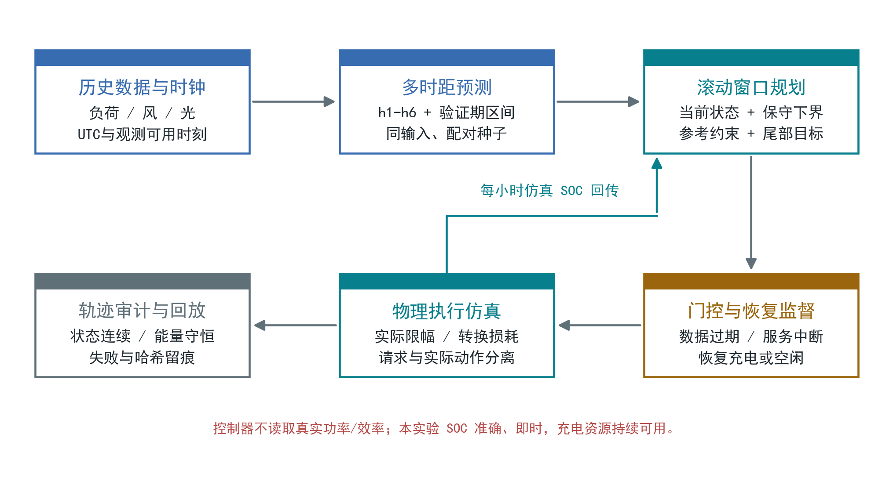
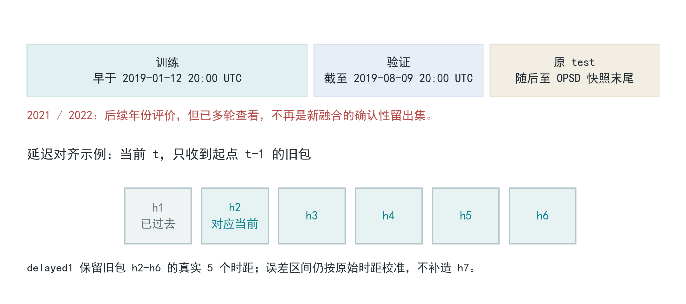
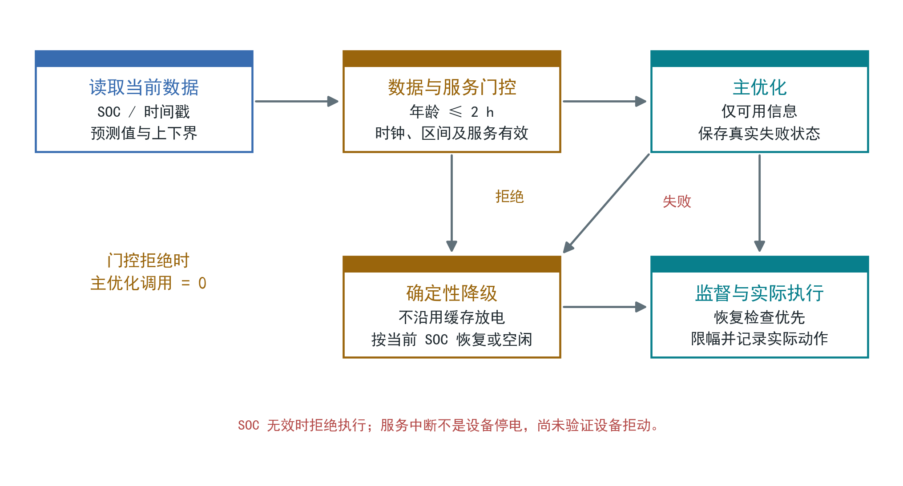
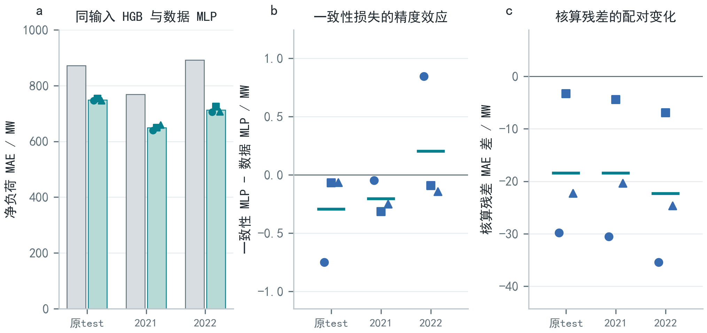
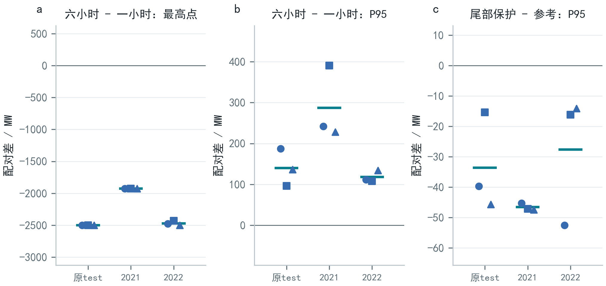
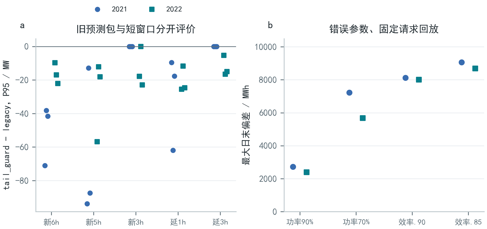
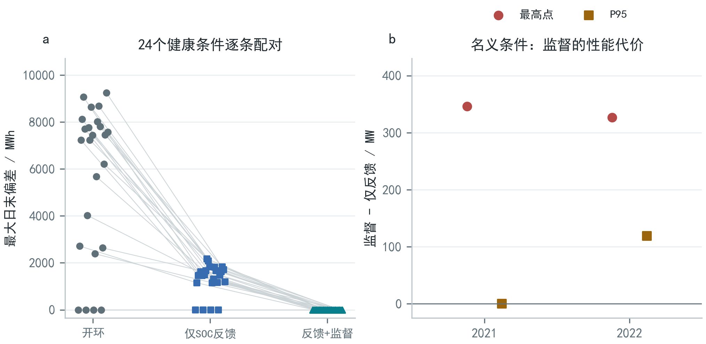
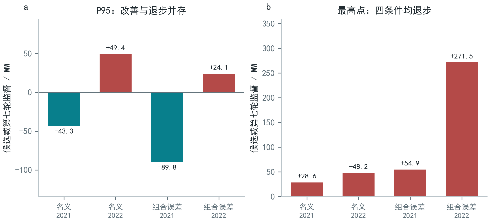
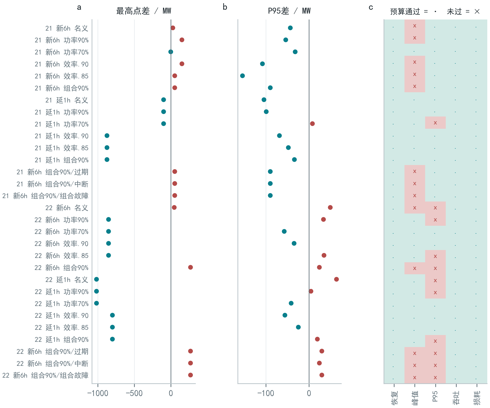
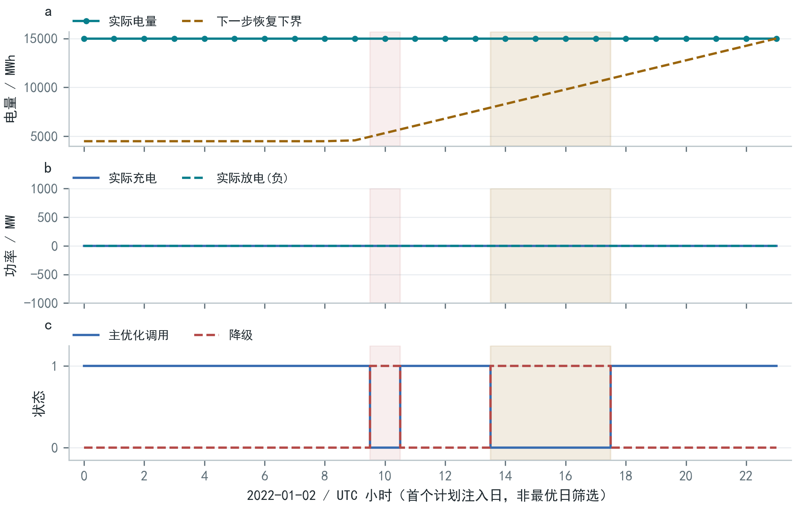

# GridPulse能源数字孪生
赛道组别：科技创新组
团队名称：________________
日期：2026年10月28日

<!-- page: 摘要 -->
## 摘要

面向风光波动下的净负荷预测与储能电量恢复问题，本文提出GridPulse能源数字孪生离线原型，将因果多时距预测、滚动规划、物理执行仿真、每小时SOC回传与失效降级连接为可审计闭环。基于德国公开小时数据，使用同输入梯度提升基线、残差神经网络及一致性消融，区分预测能力与核算自洽性。三种子结果显示，数据网络相对匹配基线的MAE下降约14%至20%，而一致性损失的精度作用微小且不一致。调度实验进一步暴露长窗口最高点改善与P95退步并存，以及错误参数开环执行的电量欠账。在准确即时SOC和预先给定功率、效率下界条件下，保守规划候选的三十条范围内评价轨迹均恢复日末电量，但仅十一条同时通过原有性能预算，范围外仍存在失败。系统保存逐小时请求、实际动作、门控与求解日志，支持数据过期及服务中断时的恢复或空闲回退。该原型可用于策略比较、故障回放和运行审查；后续研究将结合独立地区数据、设备遥测误差和电网约束检验适用范围。

关键词：人工智能；能源；数字孪生；储能恢复约束

<!-- page: 项目背景与意义 -->
## 1. 项目背景与意义

### 1.1 能源行业痛点分析

本项目面向风光波动下的聚合净负荷预测与储能运行审查。净负荷定义为系统负荷减去风电和光伏发电。研究采用德国公开小时数据，分析区域聚合需求变化及储能的削峰、补电和电量恢复过程。

预测到执行之间存在三个具体问题：平均预测误差下降不必然降低最高小时负荷；功率与SOC限幅不能自动弥补模型误差造成的日末电量缺口；数据过期和求解服务中断会使原计划失效。因此，只评价预测精度或展示一条削峰曲线，无法判断策略是否在连续运行中可执行。

### 1.2 人工智能技术应用价值

持续性和前日同小时方法提供低成本参考；梯度提升模型可学习非线性关系，残差神经网络则将多变量、多时距输出置于统一训练框架[3,4]。本文以同样本、同输入的新HGB模型作对照，再用配对种子隔离一致性正则化的作用。各算法使用预先记录的配置，但没有实施等算力调参或系统性超参数竞赛，因此只作配置内比较。

统计学习处理历史序列规律；模型预测控制以有限窗口安排动作，并随状态更新重算；物理约束学习以先验限制输出空间[5-7]。本文围绕预测误差、执行限幅和日末电量恢复，组织这些方法的接口与评价流程。

### 1.3 项目目标与意义

项目提出三项可检验目标：其一，区分数据网络的预测收益与一致性约束的核算收益；其二，同时核算最高点、P95、吞吐与转换损耗；其三，在模型参数存在误差时，检验SOC反馈、恢复监督和保守规划能否维持日末电量，并保留失效反例。

成果定位为状态级能源数字孪生离线原型。其工程意义在于用同一条逐小时轨迹连接“预测依据、请求动作、实际执行、状态回传与审计结果”，为后续影子运行提供可追溯的试验基础。

<!-- page: 总体架构设计 -->
## 2. 技术方案与实现

### 2.1 总体架构设计

系统由数据时钟、多时距预测、滚动规划、门控与恢复监督、物理执行仿真、轨迹审计六个模块组成。每小时仅执行窗口的第一个动作，再用实际仿真电量进入下一次决策。实际设备功率和效率只用于执行及事后核算，不作为控制器输入。



数字孪生采用聚合净负荷与等效储能单元的状态映射，同时保存请求、执行、参考及实际电量，并逐小时检查状态连续性与能量方程。模型的空间尺度为区域聚合系统，电网潮流、电压和输送约束留作后续接入模型。

决策优先级为硬物理边界、声明的恢复可达性、预测负荷保护与性能目标。恢复监督必要时可改写主优化动作，因而恢复约束通过与压峰性能退步可以同时发生。

<!-- page: 核心算法与模型一 -->
### 2.2 核心算法与模型

#### 2.2.1 因果预测与同输入消融

第一轮使用38个因果特征：四变量在1、2、3、24、25、168小时的滞后值，移位后的24小时均值与标准差，以及目标时刻已知的日历编码。标准化只拟合训练期。残差MLP含两个64单元SiLU隐藏层，输出负荷、光伏、风电和净负荷四变量相对最近观测的变化[4]。

各变量先除以10000 MW。令L、S、W、N分别表示系统负荷、光伏、风电和净负荷，模型损失为：

```text
N = L - S - W
Loss_data = MSE(N_hat,N) + 0.25*mean_component_MSE
Loss_cons = Loss_data + 0.2*mean((N_hat-L_hat+S_hat+W_hat)^2)
            + 0.1*mean(max(-component_hat,0)^2)
```

后一项只对负荷、光伏和风电三个分量计算；一致性项使用净负荷核算恒等式。数据与一致性分支保持相同初始化、批次及训练预算，采用种子42/43/44、AdamW学习率0.001、权重衰减0.0001、batch512、25epochs；检查点按验证净负荷MAE选择。

HGB采用学习率0.08、350次迭代上限、31叶节点及L2正则1.0。数据MLP联合监督四变量，HGB拟合净负荷。比较对象为这两套固定训练配置；网络结构和监督任务同时存在差异。

投影消融先投到核算超平面，再将分量裁剪为非负并重算净负荷。投影后的核算残差为零，预测误差仍按真实标签单独评价。

#### 2.2.2 多时距输出与误差区间

第三轮扩展至68个特征，直接输出六时距、四变量共24个预测，真实生成h1-h6而非复制h1。各分区按最远标签隔离边界；后续控制实验复用冻结预测，不为不同策略重新训练。

区间使用验证残差按原始预测时距校准，并固定用于后续年份。检查点、阈值和候选选择共用验证期，区间覆盖率及后续年份结果均按探索性评价报告。

<!-- page: 核心算法与模型二 -->
#### 2.2.3 物理状态与恢复约束

本文以电量E（MWh）表示SOC状态；SOC比例为E/C。聚合等效容量C=30000 MWh，初始、运行上限及日末目标均为15000 MWh（50%），硬下限4500 MWh（15%），可用运行电量为10500 MWh。

```text
E[t+1] = E[t] + eta*c[t]*dt - d[t]*dt/eta
N_control[t] = N_actual[t] + c_actual[t] - d_actual[t]
E_min <= E[t] <= E_max; c[t]>=0; d[t]>=0; c[t]*d[t]=0
```

Δt=1 h，c、d为充放电功率。名义双向上限各1250 MW，η=0.92为单向效率，往返效率为0.8464。实际执行按场景功率、效率和SOC余量限幅。第七/八轮整段只给一次初始电量，跨午夜不补能；此前名义日块的终端等式与跨日连续性另行核对。

若事先给定可用充电功率下界875 MW、单向效率下界0.85，则UTC小时k执行后的恢复下界为：

```text
E_floor_next(k) = max(4500,15000-(23-k)*875*0.85)
```

它表示剩余23-k个小时仍可补足到15000 MWh的最低电量。监督层限制突破此下界的放电，必要时请求恢复充电。试验假设SOC准确即时、功率和效率下界有效，剩余时段的充电资源持续可用。

#### 2.2.4 尾部目标与因果参考

```text
min mean(max(N_hat[h]+c[h]-d[h]-q90_val,0))+0.001*sum(c+d)
E_next_candidate >= E_next_reference
c[0]-d[0] <= max(c_ref-d_ref,q90_val-upper[0])
```

q90_val=51981.30 MW取自共同验证期，目标函数最小化窗口预测尾部超额与吞吐惩罚。全期P95在执行后另行计算。参考约束使用当前参考动作及下一状态。SciPy/HiGHS求解后按净电量增量规范化为单向动作，再检查可行性[5,8]。第八轮同时调整规划模型、请求上限与虚拟参考，评价这套流程的整体作用。

<!-- page: 数据处理与分析 -->
### 2.3 数据处理与分析

主序列来自Open Power System Data小时级德国负荷、风电和光伏数据，版本2020-10-06[1]；2021/2022评价使用已归档Energy-Charts德国小时快照[2]。跨来源口径和分布变化构成外推限制。



处理统一为UTC、小时步长和MW，按时间戳对齐；滞后与滚动特征先移位再计算。缺测保留缺测，不跨分区插值。训练标签早于2019-01-12 20:00 UTC；验证标签截至2019-08-09 20:00 UTC；原test自下一小时开始。多时距按最远标签执行隔离。

| 评价阶段 | 原test | 2021 | 2022 |
| --- | --- | --- | --- |
| 第一轮预测 | 10035 h | 8760 h | 8760 h |
| 第三/五轮调度 | 10008 h | 8736 h | 8736 h |
| 第六至八轮 | 不评价该段 | 8712 h | 8712 h |

第六至八轮每年为1月2日至12月30日，共363个完整UTC日。各阶段按表中样本数计算指标。所有年份均已多轮使用，新融合结论采用探索性评价口径。中国天气和太阳能资源估计文件缺少实测电站功率标签，研究数据因此保持德国来源。

<!-- page: 系统功能实现 -->
### 2.4 系统功能实现

| 功能 | 输入与输出 | 实现状态 |
| --- | --- | --- |
| 因果预测 | 历史观测→六时距点预测/区间 | 冻结模型可回放 |
| 状态执行 | 请求→限幅实际动作与电量 | 逐小时连续仿真 |
| 失效降级 | 时钟/服务/SOC→恢复或拒绝 | 保留门控与错误日志 |
| 审计展示 | 轨迹→指标、失败案例、回放 | V8结果、全部条件及故障日志 |



系统校验观测、起点、可用与决策时刻，拒绝未来包、无效区间及非有限值。默认观测年龄1 h，超过2 h即过期。每第七日UTC10注入求解服务不可用，UTC14-17注入年龄4 h旧包；每年组合门控260 h。回退按当前SOC恢复或空闲。故障注入作用于预测与求解服务，储能执行器和充电资源保持可用。

<!-- page: 实验环境与设置 -->
## 3. 实验结果与分析

### 3.1 实验环境与设置

训练manifest记录：NVIDIA GeForce RTX3090、Python3.10.14、PyTorch2.3.0+cu121、CUDA12.1、NumPy1.26.4、pandas2.2.2、scikit-learn1.5.0、SciPy1.13.1。

控制实验主要使用CPU。第八轮以最多三个单线程进程完成验证、参考及新评价，整批主流程耗时约5.09分钟；预检、传输与本机复算另计。

| 对照层次 | 固定因素 | 改变因素 |
| --- | --- | --- |
| 预测消融 | 输入、分区、配对种子、网络预算 | 数据/一致性损失及输出投影 |
| 调度消融 | 冻结六时距预测与样本 | 窗口、尾部目标及参考保护 |
| 闭环消融 | data_seed42、阈值与故障日程 | SOC反馈、监督、保守规划 |

范围内实际条件为名义1250 MW/0.92、功率1125 MW、功率875 MW、效率0.90、效率0.85、1125 MW+0.90；未注明参数保持名义值。两年×fresh6/delayed1×六条件形成24条健康轨迹，加两年三类故障共30条。范围外750 MW/0.80另计。

第五/八轮验证选择要求：每个规定种子或场景分别通过物理及日末检查，最高点不超过匹配参考+25 MW、P95不超过+1 MW，吞吐/损耗不超过110%，平均P95至少下降1 MW。第八轮仅以验证期名义和组合误差两个场景选候选，未以评价结果更换标签。

30条轨迹属于同一固定模型下的相关场景。各轮分别记录样本数、模型种子与工件复用数量。

<!-- page: 评价指标 -->
### 3.2 评价指标

| 指标 | 定义或单位 | 评价含义 |
| --- | --- | --- |
| MAE、RMSE | 预测绝对/平方误差，MW | 描述配置内预测质量 |
| 核算残差 | N_hat-L_hat+S_hat+W_hat，MW | 衡量输出之间的核算自洽性 |
| 覆盖率 | 真实值落在校准区间的比例 | 分布变化后实测报告 |
| 最高点/P95/日峰 | 全段最大值、95%分位、日最大值均值 | 可能方向相反 |
| 吞吐/损耗 | 下式，MWh | 与压峰效果共同报告 |
| 日末偏差 | 日末E与15000 MWh的绝对差 | 恢复容差1e-5 MWh |
| 失败/回退/干预 | 小时数、门控调用数 | 区分注入与自然失败 |

```text
Throughput = sum(c_actual+d_actual)*dt
Loss = sum((1-eta_actual)*c_actual
           +(1/eta_actual-1)*d_actual)*dt
```

每条轨迹还核对能量守恒、功率和SOC边界、请求与实际动作、跨日连续、负荷核算及恢复下界。日末恢复检查与硬边界检查分开：被裁剪后的动作可以不越界，却仍欠缺恢复电量。

能量与状态等式采用1e-5 MWh的数值核对容差。

随机模型先逐种子计算指标，再取三个固定种子的算术均值，图中保留原始种子或配对差值。闭环实验采用固定seed42。

平均日峰值区间采用7日循环区块、2000次配对重采样，描述固定模型在已观测日期上的变化。本报告采用点估计、配对差和条件区间呈现结果。

<!-- page: 预测结果 -->
### 3.3 结果展示与分析

#### 3.3.1 预测能力与核算一致性分别受益



| 净负荷MAE / MW | 原test | 2021 | 2022 |
| --- | --- | --- | --- |
| 持续性 | 2382.60 | 2354.40 | 2465.62 |
| 前日同小时 | 8760.67 | 8112.75 | 7685.54 |
| 同输入HGB | 871.84 | 768.80 | 892.31 |
| 数据MLP均值 | 749.02 | 649.36 | 712.14 |
| 一致性MLP原始 | 748.72 | 649.16 | 712.34 |
| 一致性MLP投影 | 747.77 | 650.31 | 709.61 |

数据MLP较匹配HGB的MAE分别降低14.09%、15.54%、20.19%，结论限于既定配置。一致性分支的配对平均MAE仅变化-0.29/-0.20/+0.20 MW，精度效应微小且不一致。

原test核算残差MAE由数据分支40.85 MW降至一致性分支22.39 MW；投影按构造为零。因此，网络预测能力和核算自洽性是两类不同收益。初期漂移启发式报警比例很高且无实测故障标签，未纳入故障识别性能主张。

<!-- page: 调度结果 -->
#### 3.3.2 更长窗口并不全面改善运行指标



真实六时距规划降低整段最高点、减少循环及损耗，但P95相对一小时分别上升140.22/286.78/117.94 MW。第二轮发现的“更准预测仍会因恢复充电制造新峰值”，由此被细化为窗口与目标的取舍，而非解释为SOC核算错误。

第四轮尾部/储备消融未通过全部验证门槛，保留legacy。第五轮在尾部目标上加入当前参考电量债务与负荷余量保护，保留tail_guard：

| tail_guard减legacy | 原test | 2021 | 2022 |
| --- | --- | --- | --- |
| P95差，MW | -33.57 | -46.59 | -27.61 |
| 最高点差，MW | 0.00 | 0.00 | 0.00 |
| 吞吐差，% | +0.56 | +1.21 | +0.96 |
| 损耗差，MWh | +297.70 | +1147.45 | +524.61 |

候选修复了部分六小时尾部退步，但P95仍高于一小时参考。收益伴随吞吐和损耗增加；未受保护配置的峰值或电量欠账保留在原始消融中。该结果不支持按单一最优指标选择通用策略。

<!-- page: 延迟与模型误差 -->
#### 3.3.3 旧预测包与错误参数暴露恢复缺口



第六轮区分新鲜短窗与陈旧包。delayed1保留旧包h2-h6，delayed3保留h4-h6，误差区间按原始lead对齐。P95差在fresh6为-50.28/-16.21 MW、delayed1为-29.75/-20.66 MW、delayed3为0/-12.23 MW（2021/2022），重度延迟下优势减弱。

delayed3的观测年龄为4 h，用于敏感性回放；第七、八轮的闭环门控将其判为过期并进入回退。

保持原请求不变、在实际功率1125/875 MW或效率0.90/0.85下连续回放，24/24条候选错误参数轨迹出现日末恢复失败，硬物理限幅仍通过。限幅只能避免违规动作，不能自动补回未执行充电和额外损耗。

已知实际参数的重规划对照可恢复电量，说明参数失配是欠账的来源之一。后续实验转向逐小时SOC反馈与恢复监督，控制器继续使用预先声明的模型参数。

<!-- page: SOC反馈 -->
#### 3.3.4 SOC反馈需要未来恢复资源的约束



第七轮每小时读取执行仿真器准确、即时的SOC，主规划仍采用1250 MW/0.92名义参数。包含健康与故障的30条范围内条件中，仅反馈有26条出现至少一天日末失败；加入875 MW/0.85恢复监督后，30/30条恢复通过。

这说明当前状态信息不能代替对未来可恢复资源的约束。恢复监督可能增加充电或抑制放电，也可能突破原有预测负荷余量保护，因此要同时检查性能代价。

| 名义fresh6，监督减仅反馈 | 2021 | 2022 |
| --- | --- | --- |
| 最高点差，MW | +346.43 | +326.84 |
| P95差，MW | +0.00 | +118.89 |

范围外750 MW/0.80时，2021/2022最大日末偏差为912.42/907.01 MWh，均判为失败。控制器参数保持固定，跨日状态连续，恢复缺口保留在轨迹中。

<!-- page: 保守规划 -->
#### 3.3.5 保守规划的恢复结果与运行代价

第八轮固定data_seed42及阈值，将875 MW/0.85同时用于窗口规划、请求功率与虚拟参考，监督层继续保留。验证期仅用名义与combined90两场景：参考式方案因P95不合格被拒绝；envelope_tail平均P95差-14.43 MW，被保留并于2026-10-28 09:55:05（北京时间）冻结。



候选30/30条范围内评价轨迹恢复通过，自然主优化失败及事后监督干预均为0。保守模型使主规划与恢复监督条件相容，减少了事后动作改写。

| fresh6损耗差 / MWh | 2021 | 2022 |
| --- | --- | --- |
| 名义 | -19071.00 | -10962.78 |
| combined90 | +2002.48 | +1630.11 |

P95有改善亦有退步，四个条件最高点均上升；名义损耗下降而组合误差损耗增加。这些结果说明，电量恢复和各项负荷指标之间仍存在取舍。

<!-- page: 全条件边界 -->
#### 3.3.6 全条件评价限定推广结论



30条均恢复，其中11条同时通过沿用的全部性能预算，其余19条至少一项未通过。统计单位为固定模型下的场景轨迹；评价期间保持验证期锁定的候选。

范围外750 MW/0.80，最大日末偏差为642.96/589.59 MWh，两年均判为恢复失败。

<!-- page: 故障回放 -->
#### 3.3.7 门控与自然求解失败分开核算



候选每年组合故障回退260 h，门控期间主优化调用0，回退动作使用当前SOC重新计算。两年均恢复日末电量。故障测试覆盖预测包过期、求解服务中断及其组合。

| combined_fault回退小时 | 2021 | 2022 |
| --- | --- | --- |
| 第七轮总回退 | 544 | 429 |
| 第八轮规定门控 | 260 | 260 |
| 第八轮自然主优化失败 | 0 | 0 |

回退次数减少主要来自自然求解失败的减少。日志分别保存服务不可用、预测过期、参考失败和主优化失败。2022故障最高点较第七轮升高约271.48 MW，电量恢复伴随峰值代价。

结果核对通过独立读取CSV重算指标、检查工件哈希及运行单元测试完成。CSV复算与主优化求解使用分离的实现。

<!-- page: 创新点与应用前景 -->
## 4. 创新点与应用前景

### 4.1 主要创新点

第一，构建预测、执行与审计分离的状态级离线孪生，把请求、实际动作、参考状态及失败原因放入同一证据链。其新增价值是让“预测更准但执行更差”的问题可定位，而非用平均误差代替运行效果。

第二，将当前因果参考电量、尾部超额及恢复知识联合用于滚动规划与监督。相对名义规划加事后纠正，保守窗口流程在声明范围内减少了求解失败和监督改写，同时明确保留峰值与损耗代价。

第三，采用同输入、配对种子、原始lead对齐和失败案例保留的验证设计，区分网络能力、核算自洽性及恢复可达性。方法贡献集中在能源场景下的模块衔接、恢复约束和可复核评价。

### 4.2 应用前景与预期效益

近期可用于公开数据教学、策略比较、故障回放和审查。面向园区/储能站的后续路径是：取得本地实测负荷及出力，接入只读遥测，认证功率/效率范围，完成影子运行，再经人工审查决定是否开放控制接口。

预期效益是降低策略审查的不透明性、暴露恢复欠账与异常动作，并减少同一配置下的部分求解失败。当前未纳入电价、设备衰减、网络费用或碳核算，不提供未经验证的节费/减排比例。

系统按版本保存模型、参数、轨迹和动作日志。界面默认展示V8保守尾部规划，提供逐小时回放、全条件对照、技术路线和工件核对。面向设备接入，保留只读遥测、操作授权、停用和动作留痕环节。

<!-- page: 结论 -->
## 5. 结论

GridPulse实现了因果多时距预测、物理执行仿真、逐小时SOC回传、恢复监督与失效降级的离线闭环。实验得到三项有边界的结论。

其一，在相同输入和评价行上，既定数据MLP配置优于匹配HGB；一致性损失主要改善核算自洽性，未稳定提高净负荷精度。其二，六小时窗口、尾部目标及恢复约束存在最高点、P95与能量损耗的取舍。其三，在准确SOC及有效恢复资源下界条件下，保守规划候选范围内30条轨迹均恢复，但仅11条通过所有原性能预算，范围外仍失败。

| 后续研究 | 关注问题 | 实施内容 |
| --- | --- | --- |
| SOC噪声/延迟/丢失 | 状态与恢复下界可能失配 | 引入估计误差界及拒绝策略 |
| 下界未知或失效 | 恢复资源估计偏差 | 设备认证或保守辨识 |
| 独立地区/时期 | 不清楚外推稳定性 | 冻结方案后获取新数据 |
| 设备、网络及价格 | 接入条件与运行成本 | 影子验证、网络与成本模型 |
| 遥测与控制接口 | 数据时效和动作权限 | 只读接入、权限与停用机制 |

后续优先使用独立地区数据检验冻结方案，加入SOC噪声、反馈延迟及下界估计误差。现有原型用于离线策略回放；设备接入按只读遥测、影子运行和授权控制三个阶段推进。

<!-- page: 参考文献 -->
## 参考文献

[1] Open Power System Data. Data Package Time Series, version2020-10-06. DOI:10.25832/time_series/2020-10-06.

[2] Fraunhofer ISE. Energy-Charts: electricity production and consumption data. 本项目使用德国2021/2022小时归档快照，获取记录随源码提供。

[3] Pedregosa F, Varoquaux G, Gramfort A, et al. Scikit-learn: Machine Learning in Python. JMLR,2011,12:2825-2830.

[4] Paszke A, Gross S, Massa F, et al. PyTorch: An Imperative Style, High-Performance Deep Learning Library. NeurIPS,2019,32.

[5] Virtanen P, Gommers R, Oliphant TE, et al. SciPy1.0: Fundamental Algorithms for Scientific Computing in Python. Nature Methods,2020,17:261-272. DOI:10.1038/s41592-019-0686-2.

[6] Boyd S, Vandenberghe L. Convex Optimization. Cambridge University Press,2004.

[7] Karniadakis GE, Kevrekidis IG, Lu L, et al. Physics-informed machine learning. Nature Reviews Physics,2021,3:422-440. DOI:10.1038/s42254-021-00314-5.

[8] SciPy Developers. scipy.optimize.linprog, method='highs'. Official API documentation. 本项目实验版本SciPy1.13.1，调用与版本见manifest。

文献[7]用于界定物理约束学习与本项目核算约束实现的区别。开源框架、优化算法和数据各按实际贡献引用，不列为原创成果。数据与软件许可遵循源码中的第三方说明，OPSD数据包和Energy-Charts不混用授权范围。

<!-- page: 附录 -->
## 附录

### A. 核心结果与工件

| 证据 | 源码目录下位置 |
| --- | --- |
| 第一轮预测 | outputs/fusion_v1/summary/summary.json |
| 多时距/尾部 | outputs/fusion_v3/metrics.json；fusion_v5/metrics.json |
| 延迟/参数 | outputs/fusion_v6_analysis.json |
| SOC闭环 | outputs/fusion_v7_analysis.json |
| 保守规划选择 | outputs/fusion_v8/selection.json |
| 全部轨迹/指标 | outputs/fusion_v8/metrics.json及对应CSV |
| 本机核对 | outputs/fusion_v8_local_verification.json |

第八轮记录包含204个工件哈希、114条轨迹和96组配对区间，其中32条逐字节复用第七轮基线。原实验的相关回归记录为138/138。本次修订同步V8回放界面和报告生成流程，冻结实验数据保持原样。

### B. 结果复算与环境说明

训练/求解使用3.1节记录的版本。已有结果的本机核对无需训练GPU；从源码根目录运行以下命令。核对脚本会生成本机回执，原始冻结工件应先保留。

```text
python scripts/verify_envelope_results.py
python scripts/analyze_envelope_results.py
python scripts/reporting/competition_figures.py
python scripts/reporting/competition_report.py
python scripts/reporting/competition_audit.py
```

报告配套CSV、可编辑SVG、矢量PDF、源文件哈希与图表QA。比较保留原分母、种子和匹配条件；图10按首个计划故障日选择。界面从冻结CSV读取轨迹，加载时核对文件哈希、时间连续性和能量平衡。
